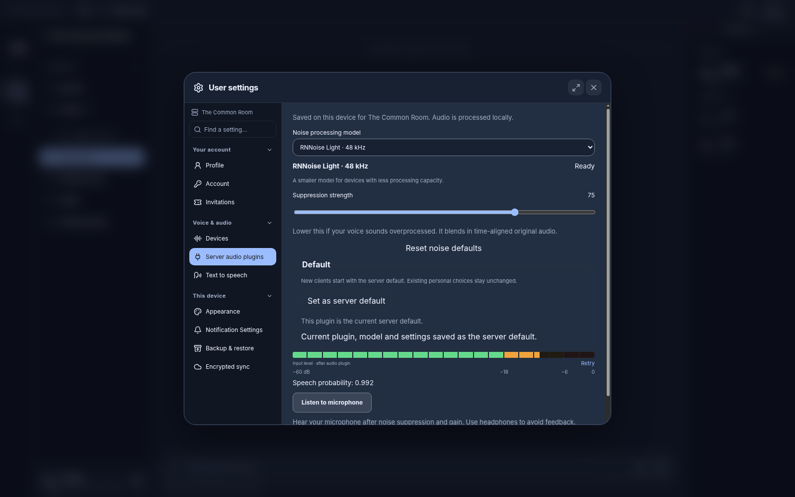

# RNNoise for Haunt

A redistributable, local noise-suppression plugin for Haunt voice calls. It adapts
[Xiph.Org RNNoise](https://github.com/xiph/rnnoise) to Haunt's restricted audio
plugin interface, with 48 kHz mono input/output and no host imports or network
requests during processing.

The package includes the full model and RNNoise Light, a smaller model for devices
with less processing capacity. Suppression strength blends filtered audio with a
20 ms delayed copy of the original, keeping both paths aligned. Speech probability
is a diagnostic only; it does not gate or mute speech. There is no echo canceller.



## Install

In Haunt, open **Server settings → Audio plugins → Install from GitHub**:

- Repository: `https://github.com/example-git/haunt-audio-rnnoise`
- Commit ID: the full 40-character revision containing the package.
- Package SHA-256: the value in `dist/SHA256SUMS` at that revision.

The server retrieves only `dist/haunt-plugin.zip`, verifies its hash and validates
the package. Installation never clones or executes this repository. Branch names
and tags are not installation pins. Alternatively, upload the ZIP through the
same settings page. A private repository requires the operator to configure
`HAUNT_AUDIO_PLUGIN_GITHUB_TOKEN_FILE` with contents-read access on the server.

Installed plugins coexist. Each user selects the plugin and model in **User
settings → Server audio plugins**. Selection and strength persist on that client
per server; switching models does not alter the microphone device or other users.
The client downloads and verifies the models once, then uses its persistent cache.

## Build

To adapt this example into your own plugin, read [Authoring a Haunt audio plugin](docs/authoring.md).

Requires Python 3 and Zig **0.15.2**:

```sh
ZIG=/path/to/zig python3 scripts/build.py
node scripts/check.mjs /path/to/a-short-speech-clip.wav
```

The build writes `dist/haunt-plugin.zip`, metadata and checksums for installation
from a pinned Git revision. Source and model versions are recorded in
`upstream.lock.json`. See the [authoring guide](docs/authoring.md) for the ABI,
reproducible build details, and audio comparison checks.

RNNoise suppresses environmental noise; it does not isolate one speaker from
other people talking.

## License

The adapter and build tooling use BSD-3-Clause. RNNoise and its official model
source are supplied by Xiph.Org under the upstream distribution's license terms;
see [THIRD-PARTY-NOTICES.txt](THIRD-PARTY-NOTICES.txt) and [LICENSE](LICENSE).

See [CONTRIBUTING.md](CONTRIBUTING.md) before submitting changes and
[SECURITY.md](SECURITY.md) for private vulnerability reports.
